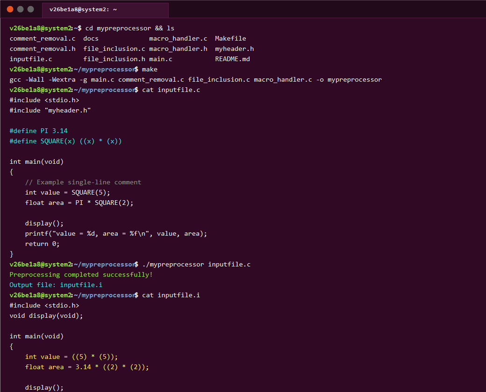

# My Preprocessor (`mypreprocessor`)

A custom C preprocessor tool developed in C that processes a C source file by performing **comment removal**, **file inclusion**, and **macro substitution**, generating an expanded source file with a `.i` extension.

---

## Table of Contents
- [Overview](#overview)
- [Key Features](#key-features)
- [Architecture & Processing Pipeline](#architecture--processing-pipeline)
- [Project Structure](#project-structure)
- [Hardware & Environment Specifications](#hardware--environment-specifications)
- [Prerequisites & Build Instructions](#prerequisites--build-instructions)
- [Execution & Usage](#execution--usage)
- [Demonstration & Sample Output](#demonstration--sample-output)
- [Reviewer Notes & Viva Questions](#reviewer-notes--viva-questions)
- [Submission Details](#submission-details)

---

## Overview

In the C compilation model, the preprocessor is the initial phase that transforms raw source code before lexical analysis and code compilation. This project implements an educational, functional C preprocessor tool named `mypreprocessor` that handles the core preprocessing responsibilities:
1. Stripping out all single-line (`//`) and multi-line (`/* ... */`) comments while preserving string and character literals.
2. Resolving and inlining user-defined quoted header files (`#include "..."`) while preserving system headers (`#include <...>`).
3. Parsing `#define` directives and replacing both object-like macros and parameterized function-like macros throughout the source code.
4. Outputting the fully expanded source code into an output file with the standard `.i` extension.

---

## Key Features

- **Comment Removal:**
  - Handles single-line comments (`// ...`) up to the newline.
  - Handles multi-line block comments (`/* ... */`) spanning across multiple lines.
  - State machine correctly ignores comment delimiters inside double quotes (`"..."`) and character constants (`'...'`).
- **File Inclusion:**
  - Detects local include directives (`#include "filename.h"`).
  - Recursively fetches and inlines the content of local header files into the processing stream.
  - Prevents multiple definition collisions by respecting `#ifndef` / `#define` / `#endif` header guards.
  - Preserves system library includes (`#include <stdio.h>`, etc.) intact for the downstream compiler.
- **Macro Substitution:**
  - **Object-like macros:** `#define PI 3.14` &rarr; substitutes occurrences of `PI` with `3.14`.
  - **Function-like macros:** `#define SQUARE(x) ((x) * (x))` &rarr; substitutes `SQUARE(5)` with `((5) * (5))`.
  - Token-boundary aware replacement to avoid matching substrings inside other variable identifiers or string literals.
- **Output Management:**
  - Automatically derives the `.i` filename from the input file (e.g., `inputfile.c` &rarr; `inputfile.i`).

---

## Architecture & Processing Pipeline

The preprocessor operates in three sequential stages using temporary streams:

```
+--------------------+
|    Input File      | (e.g., inputfile.c)
+--------------------+
          |
          v
+--------------------+
|  Comment Removal   | --> Removes // and /* */ comments
+--------------------+
          | (temporary stream 1)
          v
+--------------------+
|   File Inclusion   | --> Inlines local header files (#include "...")
+--------------------+
          | (temporary stream 2)
          v
+--------------------+
| Macro Substitution | --> Expands object-like & function-like macros
+--------------------+
          |
          v
+--------------------+
| Output (.i File)   | (e.g., inputfile.i)
+--------------------+
```

---

## Project Structure

```
my-c-preprocessor/
├── main.c              # Entry point coordinating the 3-stage preprocessing pipeline
├── comment_removal.c   # State-machine implementation for stripping comments
├── comment_removal.h   # Header declaring remove_comments()
├── file_inclusion.c    # Handler for resolving and inlining local header files
├── file_inclusion.h    # Header declaring process_includes()
├── macro_handler.c     # Parser and replacer for object-like and function-like macros
├── macro_handler.h     # Header declaring process_macros()
├── myheader.h          # Sample user header file for testing file inclusion
├── inputfile.c         # Sample input file with comments, macros, and includes
├── Makefile            # Automated build script for GCC compilation
├── .gitignore          # Git ignore rules for build artifacts and executables
├── docs/
│   └── circuit_details.md # Hardware verification and system specifications
└── README.md           # Comprehensive project documentation
```

---

## Hardware & Environment Specifications

- **Target Architecture:** x86_64 / ARMv7 / ARMv8 (ARM Cortex-A series, Raspberry Pi 3/4/5)
- **Minimum Memory (RAM):** 64 MB
- **Storage Requirement:** < 10 MB
- **Operating System:** Linux (Ubuntu 20.04/22.04 LTS / Debian / Raspberry Pi OS), POSIX-compliant environments, or WSL on Windows.
- **Circuit / Hardware Note:** As `mypreprocessor` is a systems software utility executed in user space on the target processor, no discrete external electronics or wiring circuits are required. Complete details are documented in [docs/circuit_details.md](docs/circuit_details.md).

---

## Prerequisites & Build Instructions

### Prerequisites
Install GCC and GNU Make:
```bash
sudo apt update
sudo apt install build-essential -y
```

### Build
Compile the preprocessor tool using the provided Makefile:
```bash
make
```
This generates the executable binary named `mypreprocessor`.

To clean compiled objects and generated `.i` files:
```bash
make clean
```

---

## Execution & Usage

Run the preprocessor by providing any valid C source file as an argument:

```bash
./mypreprocessor inputfile.c
```

**Console Output:**
```
Preprocessing completed successfully!
Output file: inputfile.i
```

---

## Demonstration & Sample Output

### Terminal Execution Output
Below is the execution of `mypreprocessor` in the Ubuntu Linux terminal environment (`v26be1a8@system2`):



---

### Input Source Code (`inputfile.c`):
```c
#include <stdio.h>
#include "myheader.h"

#define PI 3.14
#define SQUARE(x) ((x) * (x))

int main(void)
{
    // Example single-line comment
    int value = SQUARE(5);
    float area = PI * SQUARE(2);

    display();
    printf("value = %d, area = %f\n", value, area);
    return 0;
}
```

### Preprocessed Output (`inputfile.i`):
```c
#include <stdio.h>
void display(void);

int main(void)
{
    int value = ((5) * (5));
    float area = 3.14 * ((2) * (2));

    display();
    printf("value = %d, area = %f\n", value, area);
    return 0;
}
```

---

## Reviewer Notes & Viva Questions

### Key Technical Talking Points:
1. **Comment Removal State Machine:**
   - How are quotes handled? When entering state `1` (double quotes) or state `2` (single quotes), slash characters `/` are treated as literal text and not stripped.
2. **File Inclusion Strategy:**
   - Distinguishes `<...>` (system headers retained for compiler standard library) from `"..."` (local project headers read using `fopen` and inlined recursively).
3. **Macro Handling:**
   - Detects `#define` tokens at line starts, stores macro signatures and substitution bodies in symbol tables, and substitutes them across subsequent lines before clearing the `#define` directive line.
4. **Temporary Stream Safety:**
   - Uses `tmpfile()` to hold intermediate pipeline stages in memory/system temp space, ensuring source files are never corrupted.

---

## Submission Details

- **Project Title:** My Preprocessor (`mypreprocessor`)
- **Author:** Ajay Murugan
- **GitHub Repository:** [https://github.com/Ajay-286320/mypreprocessor](https://github.com/Ajay-286320/mypreprocessor)
